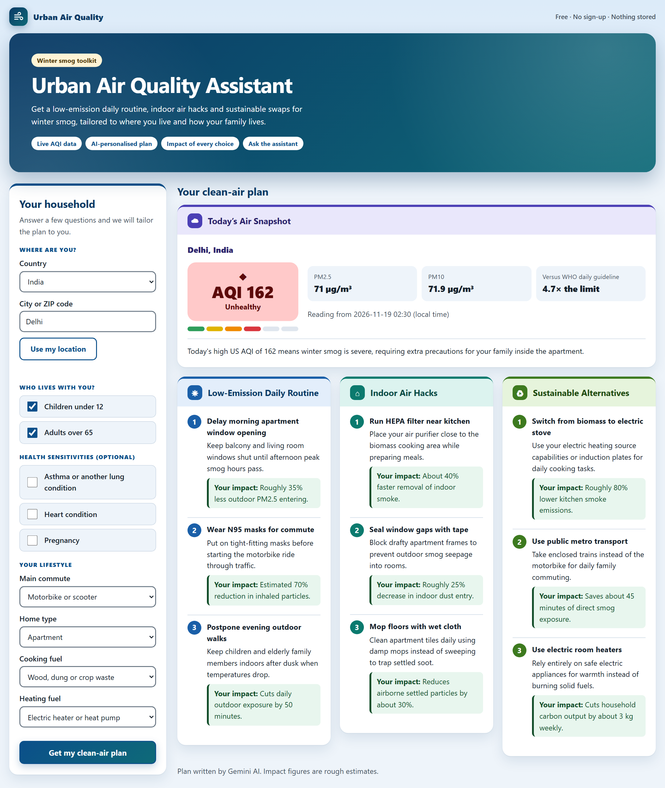
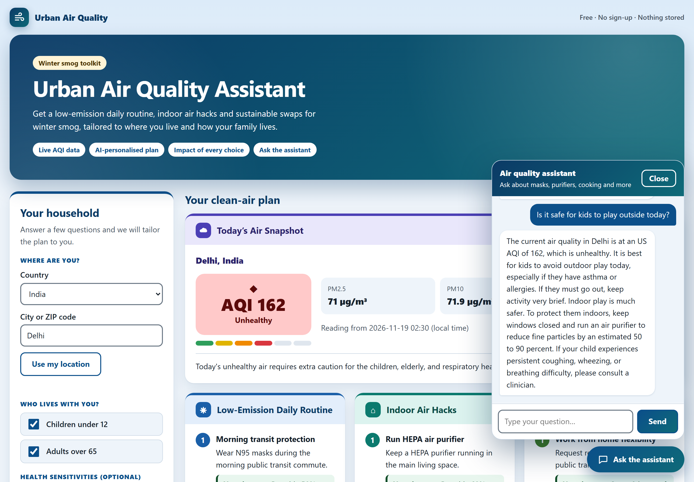

# Urban Air Quality Assistant

> A Gemini-powered web app that helps families and communities get through severe winter smog.

## Description

Winter smog turns everyday choices into health decisions: whether children can play outside, which
mask to wear, whether to open a window, how to cook and heat the home. Generic advice does not help
because the right answer depends on **where you live, today's air and how your household lives**.

Urban Air Quality Assistant asks a few simple questions (location, who lives at home, commute, home
type, cooking and heating fuel), reads the **live air quality** for that place and uses **Google
Gemini** to write a personal plan with four parts:

1. **Today's Air Snapshot**: live AQI and PM2.5, explained for your household.
2. **Low-Emission Daily Routine**: what to do through the day.
3. **Indoor Air Quality Hacks**: practical ways to keep indoor air cleaner.
4. **Sustainable Alternatives**: lower-emission swaps for commuting, cooking and heating.

Every suggestion ends with a **"Your impact"** line that quantifies the direct effect of that choice
(for example "about 40% faster removal of indoor smoke"). A floating **chat assistant** answers
follow-up questions and can see the reading currently on screen.





## How it works

```
Browser form ──► POST /api/advice
                   │ 1. cross-site, rate-limit, size and content-type checks
                   │ 2. Zod validation of every field
                   │ 3. geocode the place        (Open-Meteo; OpenStreetMap for non-US postcodes)
                   │ 4. live AQI / PM2.5         (Open-Meteo Air Quality)
                   │ 5. Gemini writes the plan   (instructions and user data kept apart,
                   │                              JSON schema output, re-validated with Zod)
                   ▼ 6. dashboard renders snapshot + 3 sections, each with "Your impact"
Chat widget ───► POST /api/chat ──► Gemini (answers only about air quality)
```

- **Inputs:** a country (India by default) plus city, ZIP or PIN code, or the device location;
  children, adults over 65 and health sensitivities; commute mode; home type; cooking and heating
  fuel.
- **Grounding:** the live AQI and PM2.5 are injected into the prompt, so advice reflects today's air
  and not generic tips.
- **Structured output:** Gemini must return JSON that matches a strict schema. Anything else is
  rejected and the next model is tried.
- **All third-party calls happen on the server.** The browser only talks to its own origin, and the
  Gemini key never leaves the server.

## Key features

### Personalised advice

- Plan tailored to location, live AQI, household members, health sensitivities, commute, home
  type and fuels.
- Country dropdown (India by default) so a bare PIN or ZIP code such as `600001` resolves to the
  right city.
- Every suggestion carries a quantified **Your impact** line (the schema rejects impacts without a
  number).

### Always-on Gemini

- Gemini is the only AI used. The server tries five Gemini models in order and switches when one is
  exhausted (429), overloaded (503), retired (404), slow or returns an unusable reply.
- If a model has not answered after 4 seconds, the next one starts in parallel and the first valid
  reply wins. Overloaded models get one quick retry.
- If every model fails, the plan falls back to built-in guidance and the chat answers from built-in
  answers. Both are deterministic, clearly labelled and never leave the user with an error screen.

### Floating chat assistant

- Bottom-right launcher, suggested questions and a conversation that knows the current city and AQI.
- Stays on topic (air quality only) and refuses attempts to change its rules.
- Keyboard and screen-reader friendly: dialog and log roles, Escape closes, focus returns.

### Security and privacy

- Validated and sanitised input, prompt-injection defences, nonce-based Content Security Policy and
  a full set of security headers.
- Rate limits per client (10 plans and 20 chats a minute) that hold across every serverless
  instance when a free Redis database is connected, with automatic fallback to per-instance
  counting. Client addresses are hashed before they are stored anywhere.
- Request bodies are size-capped while they are being read, in bytes, and cross-site browser
  requests are rejected, so other websites cannot spend the Gemini quota.
- The server contacts only three allow-listed hosts, over HTTPS, with a timeout and no redirects.
  Gemini replies are validated against a strict schema and stripped of control characters.
- The Gemini key is read in one file (`src/lib/config.ts`) and never reaches the browser; a test
  scans the source to keep it that way.
- Nothing about users is stored: no database, no cookies, no logging of inputs. Device coordinates
  are rounded to about 1 km. See [SECURITY.md](SECURITY.md).

### Accessible and fast

- WCAG 2.2 AA: landmarks, skip link, labelled controls, visible focus, colour never the only signal
  (AQI is shown as number, words and a shape), reduced-motion support, responsive from 320 px.
- Server-rendered page, lazy-loaded results and chat, cached air data and cached AI answers.

## Technology stack

| Area       | Choice                                                                                                                                         |
| ---------- | ---------------------------------------------------------------------------------------------------------------------------------------------- |
| Framework  | Next.js 16 (App Router, Turbopack), React 19                                                                                                   |
| Language   | TypeScript 5.9 in strict mode with `noUncheckedIndexedAccess`                                                                                  |
| GenAI      | Google Gemini through the official `@google/genai` SDK, server-side only                                                                       |
| Data       | Open-Meteo (geocoding and air quality, keyless), OpenStreetMap Nominatim (non-US postcodes)                                                    |
| Validation | Zod 4 for requests, Gemini output and upstream responses                                                                                       |
| Styling    | Hand-written CSS with design tokens, no UI framework and no web fonts                                                                          |
| Quality    | ESLint with enforced limits (complexity 10, 30 lines per function, 200 per file, no magic numbers), Prettier, strict `tsc`, CodeQL, Dependabot |
| Testing    | Vitest, React Testing Library, axe-core, Playwright, v8 coverage                                                                               |
| CI and CD  | GitHub Actions (lint, format, types, tests, audit, e2e, CodeQL); deployment target Vercel                                                      |

## Folder structure

```
.
├── src/
│   ├── app/
│   │   ├── page.tsx               Page: skip link, header, dashboard, footer
│   │   ├── layout.tsx             Root layout and metadata
│   │   └── api/
│   │       ├── advice/route.ts    POST: guard → advice service → JSON
│   │       └── chat/route.ts      POST: guard → Gemini chat, or built-in answers
│   ├── components/
│   │   ├── AdvisorForm.tsx        Composes the form, results panel and chat
│   │   ├── LocationFieldset.tsx, HouseholdFieldsets.tsx   Form sections
│   │   ├── PlanPanel.tsx          Placeholder, progress, error or plan; focus handling
│   │   ├── Results.tsx, SnapshotCard.tsx, AqiBadge.tsx    The plan (lazy-loaded)
│   │   ├── ChatWidget.tsx, ChatPanel.tsx   Floating chat (lazy-loaded)
│   │   ├── SiteHeader.tsx         Header, hero and footer
│   │   ├── use-advice.ts, use-chat.ts, use-device-location.ts   Hooks
│   │   └── advice-request.ts, chat-request.ts   Request building and API calls
│   ├── lib/
│   │   ├── advice-service.ts      Orchestration: locate → air data → Gemini → fallback
│   │   ├── gemini.ts              Gemini calls and reply parsing
│   │   ├── model-failover.ts      Model switching, parallel start, retry, cool-downs
│   │   ├── prompt.ts              System instructions kept apart from user data
│   │   ├── schemas.ts, options.ts, limits.ts   Zod schemas, form options, every size limit
│   │   ├── geocoding.ts, air-quality.ts, aqi-levels.ts   Place lookup, live AQI, EPA scale
│   │   ├── upstream.ts            Allow-listed, time-limited fetch for third-party APIs
│   │   ├── fallback.ts, fallback-content.ts, chat-fallback.ts   Built-in guidance
│   │   ├── config.ts              The only place environment variables are read
│   │   ├── api-guard.ts           Shared route checks: site, rate limit, size, schema
│   │   ├── http.ts, http-status.ts, rate-limit.ts   Request helpers and rate-limit stores
│   │   └── cache.ts, sanitize.ts, csp.ts, errors.ts
│   ├── styles/                    index.css imports 13 focused stylesheets in cascade order
│   └── proxy.ts                   Per-request nonce Content Security Policy
├── tests/                         Unit, component, API-route, accessibility and architecture tests
├── e2e/happy-path.spec.ts         Playwright end-to-end tests
├── docs/                          README screenshots
├── .github/                       CI, CodeQL and Dependabot configuration
├── eslint.config.mjs              Base lint rules
├── eslint.quality.config.mjs      Adds the size, complexity and magic-number limits (used by lint)
├── SECURITY.md, LICENSE           Security policy and MIT licence
├── .env.example                   Environment variable template (no secrets)
└── next.config.ts                 Security headers
```

## Getting started

```bash
npm install
cp .env.example .env.local   # then set GEMINI_API_KEY
npm run dev                  # http://localhost:3000
```

| Variable                                             | Required | Purpose                                                                                     |
| ---------------------------------------------------- | -------- | ------------------------------------------------------------------------------------------- |
| `GEMINI_API_KEY`                                     | yes      | Server-side Gemini key. Never exposed to the browser.                                       |
| `GEMINI_MODELS`                                      | no       | Comma-separated Gemini models, tried in order (defaults built in)                           |
| `UPSTASH_REDIS_REST_URL`, `UPSTASH_REDIS_REST_TOKEN` | no       | Free Redis database so rate limits are shared across instances (`KV_REST_API_*` also works) |

Scripts: `npm run lint` (base rules plus the quality limits), `format:check`, `typecheck`,
`test:coverage`, `e2e`, `audit:deps` and `verify` (lint, format, types and coverage together).

**Deploy to Vercel:** import the repository (framework preset Next.js), add `GEMINI_API_KEY` under
Project → Settings → Environment Variables and deploy. No other configuration is needed. Use a key
from a Google AI project with billing enabled for production-level quotas; free-tier keys have low
limits and can be exhausted.

## Evaluation criteria

| Criterion                 | Evidence                                                                                                                                                                                                                                                                                                                                                                                                                                                                                                                                                                                                                                                                                                                                                                                                                                                       |
| ------------------------- | -------------------------------------------------------------------------------------------------------------------------------------------------------------------------------------------------------------------------------------------------------------------------------------------------------------------------------------------------------------------------------------------------------------------------------------------------------------------------------------------------------------------------------------------------------------------------------------------------------------------------------------------------------------------------------------------------------------------------------------------------------------------------------------------------------------------------------------------------------------- |
| **Code quality**          | Every function is at most 30 lines with complexity at most 10, every file at most 200 lines and there are no magic numbers: `npm run lint` fails otherwise (`eslint.quality.config.mjs`). Small modules with one job each: route → guard → service → clients; configuration only in `src/lib/config.ts`; all limits in `limits.ts`, HTTP codes in `http-status.ts`, AQI levels in `aqi-levels.ts`; failover engine (`model-failover.ts`) separate from the Gemini client; fallback content separate from fallback logic; UI split into hooks and small components; 13 focused stylesheets; strict TypeScript with unused-code and implicit-return checks; Prettier and `.editorconfig`; JSDoc on exported functions; no dead code.                                                                                                                             |
| **Security**              | Key read only in `src/lib/config.ts` and never in the browser bundle (enforced by `tests/architecture.test.ts`); `.env*` git-ignored; Zod validation (closed enums, strict objects, pattern-checked location, country allow-list, validated model names, length caps from `limits.ts`); shared route guard (`src/lib/api-guard.ts`) with cross-site rejection, rate limiting (global with optional Redis, hashed keys) and byte-capped body reading; outbound calls only to three allow-listed HTTPS hosts with timeouts and no redirects (`src/lib/upstream.ts`); Gemini output schema-validated and cleaned of control characters; errors never cached or leaked; nonce CSP without `unsafe-inline` or `unsafe-eval` in production plus HSTS, CORP, COOP, Permissions-Policy; `npm audit` clean (production and full); CodeQL, Dependabot and `SECURITY.md`. |
| **Efficiency**            | Server-rendered page; results view and chat lazy-loaded; no web fonts; air data cached for 15 minutes; Gemini answers cached for 15 minutes per household, place and pollution band; upstream timeouts; model cool-downs so failed models are not retried needlessly; plans take about 3 to 5 seconds.                                                                                                                                                                                                                                                                                                                                                                                                                                                                                                                                                         |
| **Testing**               | 293 unit, component, API and architecture tests plus 6 Playwright tests; 100% statement, branch, function and line coverage (gate of 90% in `vitest.config.ts`); external services mocked; every module has its own test file; CI runs lint, format, types, tests, audit and e2e.                                                                                                                                                                                                                                                                                                                                                                                                                                                                                                                                                                              |
| **Accessibility**         | Semantic landmarks and headings, skip link, labelled controls, full keyboard use, focus moved to results after submit, `aria-live` results, `role="alert"` errors, contrast of every colour pair tested (`tests/contrast.test.ts`), axe-core tests on every state, Lighthouse Accessibility 100.                                                                                                                                                                                                                                                                                                                                                                                                                                                                                                                                                               |
| **Problem statement fit** | Low-emission routines, indoor air hacks and sustainable alternatives, tailored to location and lifestyle, each with a quantified "Your impact" line; live air data grounds every plan; the chat assistant answers follow-up questions.                                                                                                                                                                                                                                                                                                                                                                                                                                                                                                                                                                                                                         |

**Known gaps (honest self-assessment):**

- Mobile Lighthouse Performance varies between 93 and 99 across runs (median 96) because React
  hydration time depends on CPU load; every other Lighthouse score is 100.
- Rate limits are global only when a Redis database is connected (otherwise per serverless instance), and the AI answer cache is per instance.
- Impact figures are model estimates and are labelled as such in the UI.

## Testing results

Measured on the production build in November 2026.

| Check                                       | Result                                                                                                                                     |
| ------------------------------------------- | ------------------------------------------------------------------------------------------------------------------------------------------ |
| Unit, component, API and architecture tests | **293 passed** in 24 files, 0 failed                                                                                                       |
| End-to-end (Playwright, Chromium)           | **6 passed**: keyboard happy path, error alert, CSP and headers, chat, API validation                                                      |
| Coverage                                    | Statements **100%**, branches **100%**, functions **100%**, lines **100%**                                                                 |
| Quality gates                               | Complexity 10, 30 lines per function, 200 per file, no magic numbers: **0 violations**; Prettier clean; strict `tsc` clean                 |
| Dependency audit                            | `npm audit` (production and full): **0 vulnerabilities**                                                                                   |
| Lighthouse, desktop                         | Performance **100**, Accessibility **100**, Best Practices **100**, SEO **100**                                                            |
| Lighthouse, mobile (throttled)              | Performance **93 to 99** across five runs, Accessibility **100**, Best Practices **100**, SEO **100** (LCP 0.8 s, CLS 0)                   |
| Size                                        | Client assets 590.6 KiB raw / 182.5 KiB gzip; page weight 156 KiB                                                                          |
| Live Gemini check                           | plans written by Gemini in about 3 to 5 s; chat in about 2 s; injection attempt refused; cross-site request gets 403; 200 KB body gets 413 |

What the tests cover: input validation and injection attempts, rate limiting (memory and Redis
stores), the host allowlist, error responses that never leak internals, Gemini failover (429, 503,
404, timeouts, bad JSON, parallel start, retry and cool-downs), the built-in fallbacks, the chat
widget, colour contrast, axe-core accessibility on the empty, success and error states, the security
headers, and structural rules (the key is read in one file, the browser bundle imports no server
code, no `eval` or `innerHTML`).

Run them yourself: `npm run verify` for lint, format, types and coverage, and `npm run e2e` for the
browser tests.

## Future improvements

- Share the AI answer cache across instances through the same Redis database used for rate limits.
- Streaming plan output so the first suggestions appear while the rest is still being written.
- Multilingual interface and answers (Hindi and other regional languages).
- Air-quality forecasts and alerts, so families can plan the next days and not only today.
- Optional saved households (with consent) and a simple history of past readings.
- Neighbourhood-level data from local monitoring stations where available.
- Voice input and read-aloud for the chat assistant.
- A larger country list and a map-based location picker.

## License

MIT. See [LICENSE](LICENSE).
